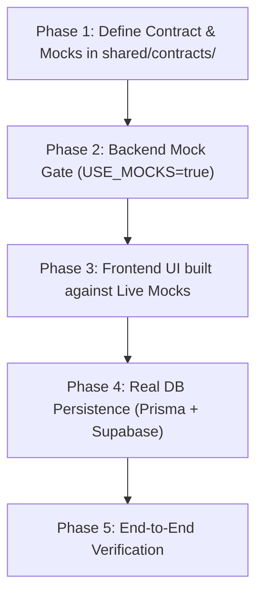

# AGENTS.md — Full-Stack Integration & Contract-First Protocol

> **CRITICAL DIRECTIVE FOR ALL AI AGENTS WORKING ON THIS REPOSITORY:**
> You must strictly follow the **Contract-First Architecture** defined in this document.
> Developing frontend and backend in silos without a prior frozen contract causes integration mismatch bugs.
> Any feature implementation that violates this protocol will be rejected.

---

## 🎯 The Core Problem & Our Solution

### The Failure Mode
Traditional AI agent implementations fail because:
1. The backend agent generates an endpoint (e.g., `POST /api/v1/user` returning `{ user_id, user_name }`).
2. The frontend agent independently builds components calling `POST /api/users` expecting `{ id, name }`.
3. Integrating them later requires massive, error-prone refactoring of types, endpoints, and mock states.

### The Solution: Contract-First & Mock-Driven Architecture
Every feature starts with a **Shared Zod Contract** and **Canonical Mock Dataset** in `shared/contracts/`.
- Frontend consumes real HTTP responses from day 1 (via Express mock toggle `USE_MOCKS=true`).
- Backend guarantees identical payload structures whether serving mocks or real Prisma queries.
- TypeScript enforces contract compliance across the entire stack.

---

## ⚡ The 5-Phase Strict Protocol

Whenever an agent or developer implements a feature, you **MUST** follow these 5 phases sequentially:



### Phase 1: Contract & Schema Definition
Before touching any UI component or database query:
1. Create or update a file in `shared/contracts/<feature>.ts`.
2. Define:
   - **Entity Schema** (e.g. `UserSchema = z.object({ ... })`)
   - **Request Schemas** (e.g. `CreateUserRequestSchema`)
   - **Response Schemas** (e.g. `UserListResponseSchema`)
   - **Inferred TypeScript Types** (`export type User = z.infer<typeof UserSchema>`)
   - **Canonical Mock Dataset** (`export const MOCK_<FEATURE>: Entity[] = [ ... ]`)
3. Export from `shared/contracts/index.ts`.

### Phase 2: Backend Mock Gate
1. Create the Express route in `server/src/routes/<feature>.ts`.
2. Support `USE_MOCKS = process.env.USE_MOCKS === 'true'`.
3. When `USE_MOCKS` is active, return the typed mock dataset immediately.
4. Validate incoming requests using `RequestSchema.parse(req.body)`.
5. **Gate Requirement**: Verify the endpoint responds over HTTP (`curl` or `Invoke-RestMethod`) before writing frontend code.

### Phase 3: Frontend UI on Live Mocks
1. Import the shared types into React components:
   ```typescript
   import type { User, UserListResponse } from '@shared/contracts/users.js'
   ```
2. Build UI components using shadcn/ui and Tailwind CSS.
3. Fetch data over real HTTP via the Vite `/api` proxy.
4. Handle loading, error, empty, and populated states with real network responses.

### Phase 4: Real DB & Business Logic (Prisma + Supabase)
1. Add/update models in `server/prisma/schema.prisma`.
2. Run `npm run prisma:push` (fast prototype) or `npm run prisma:migrate`.
3. In the Express route, implement the Prisma query behind the mock fallback:
   ```typescript
   if (USE_MOCKS) {
     res.json({ success: true, data: mockStore })
     return
   }
   // Real Prisma query returning the EXACT same payload structure
   const data = await prisma.user.findMany(...)
   res.json({ success: true, data })
   ```
4. Payload format must match the Phase 1 contract identically.

### Phase 5: End-to-End Verification
1. Flip `USE_MOCKS=false` in `server/.env` to verify real database persistence.
2. Confirm the frontend UI behaves identically in both mock mode and database mode.
3. Run `npm run build` from root to ensure both client and server pass type checking.

---

## 🔒 Contract Invariance & Evolution Rules

1. **Non-Breaking Evolution**:
   - Existing field names and data types are **immutable**.
   - If requirements evolve during the hackathon, new fields must be **optional** (`z.optional()`).
   - If a schema change is required, the agent **must update the contract, mock data, backend response, and frontend types simultaneously in the same step**.
2. **Date Serialization Standard**:
   - Dates in contracts must be ISO strings (`z.string().datetime()`).
   - In Express Prisma handlers, always serialize `createdAt.toISOString()`.
3. **No Phantom Endpoints**:
   - Never invent or call an endpoint in frontend code that has not been specified in `shared/contracts/`.

---

## 📂 Code Layout & Import Aliases

| Location | Path Alias | Example Import |
| --- | --- | --- |
| Shared Contracts | `@shared/*` | `import { UserSchema } from '@shared/contracts/users.js'` |
| Client Source | `@/*` | `import { Button } from '@/components/ui/button'` |
| Server Source | Relative / `@shared/*` | `import { prisma } from '../lib/prisma.js'` |

---

## 🛠️ Required Agent Skills (Supabase)

Before performing any Supabase, database, or schema-related operations, verify if the official Supabase agent skills are installed in the workspace (look inside `.agents/skills/supabase` and `.agents/skills/supabase-postgres-best-practices`).

If they are not present, **you must install them immediately** by running:
```bash
npx skills add supabase/agent-skills
```
These skills provide authoritative Postgres best practices, security configurations, and query guidelines for Supabase.

---

## 📋 Agent Turn Checklist

Before concluding your turn or declaring a task complete, verify:
- [ ] Are Supabase agent skills installed (`npx skills add supabase/agent-skills` if missing)?
- [ ] Has a contract schema been written in `shared/contracts/`?
- [ ] Does the backend mock handler return data matching the contract?
- [ ] Does the frontend import types from `@shared/contracts/` rather than defining ad-hoc types?
- [ ] Did `npm run build` succeed for both client and server?

